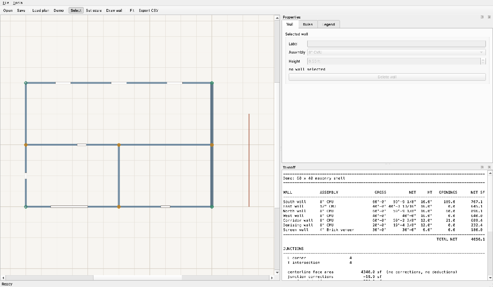
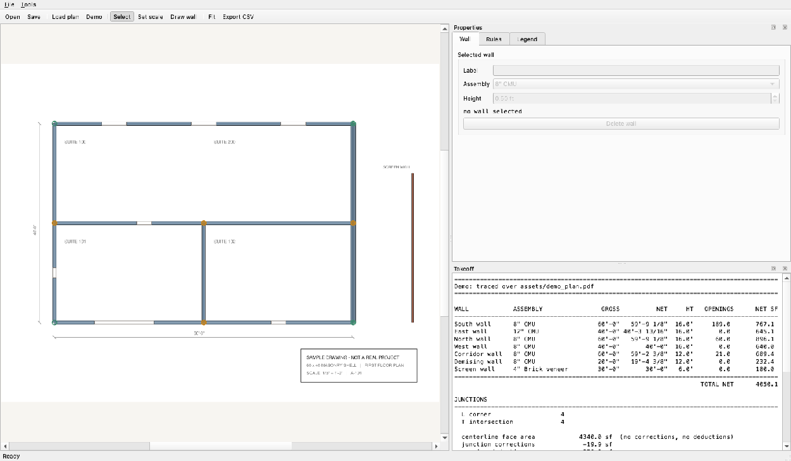

# Coursework

A masonry quantity takeoff tool that refuses to count the same block twice.

Trace the walls on a floor plan, assign assemblies, and get a bill of
materials. The part worth looking at is what happens where walls meet.



Traced over the sample drawing, with the junction dots on every corner and
intersection (`coursework ui --demo-plan`):



---

## The problem it solves

Masonry is measured along wall centerlines. That convention has a property
most takeoffs rely on without stating, and it only holds in one place.

**At an L corner, centerline measurement is exactly self-correcting.** Put
wall A along +x with thickness `ta` and wall B along +y with thickness `tb`,
both ending at the origin:

```
    A covers   x in [0, La],     y in [-ta/2, ta/2]
    B covers   y in [0, Lb],     x in [-tb/2, tb/2]

    overlap    x in [0,  tb/2],  y in [0,  ta/2]     area = ta*tb/4
    notch      x in [-tb/2, 0],  y in [-ta/2, 0]     area = ta*tb/4
```

The overlap gets counted twice. The notch, the outer corner, gets counted by
nobody. The two areas are equal for *any* pair of thicknesses, so they cancel.
A closed loop of walls measured on the centerline gives exactly the right
material. That is why the convention survives.

**Nowhere else does it cancel:**

| Junction | What goes wrong | Correction |
|---|---|---|
| **L corner**, same assembly | nothing, overlap and notch cancel | none |
| **L corner**, mixed assembly | total is right, the *split* is wrong: the overlap lands in both bills of material and the notch in neither | move `t_owner/4` off the non-owner, `t_other/4` onto the owner |
| **T intersection** | the butting wall runs to the host's centerline | butting wall loses `t_host / 2` |
| **X crossing** | the non-owning wall runs clean through the owner | non-owner loses `t_owner` |

On the sample building that is 1.27 ft of wall, about 20 sf, roughly 0.5% of
the job. On a plan with many interior partitions it grows with every
intersection. CMHA's TEK 04-02A makes the same point from the other side: it
warns that layouts with numerous returns and corners significantly increase
both unit count and mortar volume.

The mixed-assembly case is the one worth knowing about. When 8" block meets
4" brick veneer, the total plan area is already correct, so a tool that only
reports one total looks fine. But the block and the brick are two separate
purchase orders, and the shared corner is in both of them.

---

## Quick start

```bash
python -m venv .venv && source .venv/bin/activate
pip install -e ".[dev]"

coursework report --demo          # takeoff for the sample building
coursework export --demo -o t.csv # same thing as CSV
coursework ui                     # the desktop app
coursework bench                  # junction detection benchmark
pytest -q                         # 177 tests
```

`coursework ui` opens with the sample building loaded. `assets/demo_plan.pdf`
is a sample drawing at 1/8" = 1'-0" to trace over: **Load plan**, then
**Set scale**, click the two ends of the printed 60'-0" dimension and type
`60'`, then **Draw wall**. `coursework ui --demo-plan` skips the tracing and
shows the finished overlay.

Click any junction dot on the canvas and the status bar says what it did and
why:

```
T intersection (walls 1, 6): wall 6 butts into wall 1;
removed half the host thickness -> wall 6 -0'-3 13/16"

L corner (walls 1, 2): mixed assembly corner: cmu12 takes the corner
from cmu8 -> wall 1 -0'-2 7/8"; wall 2 +0'-1 7/8"
```

---

## What the report shows

```
WALL            ASSEMBLY                GROSS          NET     HT   OPENINGS      NET SF
----------------------------------------------------------------------------------------
South wall      8" CMU                 60'-0"   59'-9 1/8"  16.0'     189.0       767.1
East wall       12" CMU                40'-0" 40'-3 13/16"  16.0'       0.0       645.1
...
  centerline face area            4340.0 sf  (no corrections, no deductions)
  junction corrections             -19.9 sf
  opening deductions              -270.0 sf
  net face area                   4050.1 sf
  overstated by                    289.9 sf  (6.68%)
```

The east wall reads *longer* than its gross length. It is 12" block, so it
takes the corner from the 8" walls at both ends. That transfer is visible
rather than silently absorbed.

---

## The numbers, and where they come from

Every constant is a published trade figure, not something invented here. They
are defaults: a shop that buys different units or runs a different joint edits
them, and the report prints whatever was actually used.

| Quantity | Value | Source |
|---|---|---|
| 8x8x16 and 12x8x16 CMU | 1.125 units/sf of wall face | 3/8" joint; both present the same 8"x16" face, so thickness does not change the rate |
| Modular brick | 6.75 units/sf | NASCLA contractor study guide (others quote 6.86 from the raw formula, or 7 flat as a field rule) |
| Mortar, block | 3 bags per 100 block | Titan America Block Estimating Guide |
| Mortar, brick | 7 bags per 1000 brick | same |
| Sand | 1 CY per 7 bags | same |
| Waste | 5% default, 5-10% typical | standard allowance for breakage, spillage and error |

Sources disagree on mortar. One calculator quotes 2.5 bags per 100 block, and
volume-based methods derived from joint thickness land higher. The Titan
figures are the default because they come from a manufacturer and are stated
on a consistent basis. `src/coursework/quantities/catalog.py` carries the full
note.

Wall thicknesses are **actual**, not nominal: 8" block is 7-5/8" of material.
Using nominal thickness would overstate every junction correction by 5%.

Openings at or below 10 sf are not deducted by default, because the material
saved is offset by cutting and jamb labour. That threshold is a setting and
prints on the report.

---

## How it is checked

The solver works analytically: it reasons about what each junction does to a
wall's measured length. Tests answer the same question a completely different
way and compare.

`tests/oracle.py` merges all the wall centerlines into connected linework and
lets shapely buffer it by half the thickness with mitred joins, which fills
outer corners the way a mason does. It measures the resulting polygon. **It
shares no code and no reasoning with the solver.** Across closed shells,
random buildings, every thickness, and n x n lattices of nothing but
crossings, the two agree to 1 part in 10^9.

Shapely is a test-only dependency. It never reaches production code, and a
test enforces that.

The rest of the suite:

- **Known-answer cases** with the arithmetic written into each docstring, so a
  failure says what the answer should have been without anyone reading the
  solver.
- **Invariance**: translation, rotation, wall ordering, vertex reversal, and
  scaling all leave the quantities alone.
- **Index agreement**: the fast path must return junctions identical to the
  all-pairs scan.
- **Layering**: no Qt outside `ui/`, no shapely in `src/`.
- **UI**: the window runs headless on Qt's offscreen platform, so the wiring
  from an edit to the number it produces is covered in CI.
- **End to end**: render the sample PDF, calibrate off its printed dimension,
  and confirm the recovered scale is the 18.75 px/ft the drawing was made at.

```
177 passed in 1.30s
```

---

## Performance, including the part I got wrong

Two stages could blow up on a large plan: deciding which wall segments might
touch (O(n^2) in segments), and collapsing pairwise hits that land on the same
point into one junction (O(n^2) in hits).

Stage one looks like the expensive one, so it got a uniform grid hash first.
Profiling a 24x24 lattice then showed where the time actually went:

```
3 ms    segment intersection testing
229 ms  clustering
```

The index had been aimed at the wrong stage. Clustering now hashes nodes into
cells too, and both implementations are kept so the benchmark can show the
difference and the tests can prove they agree.

```
A. Lattice: every wall spans the whole plan
 WALLS  SEGS   JUNC   PAIRS n^2  PAIRS idx    CUT   SLOW ms   FAST ms  SPEEDUP  PAIR%
   128   128   4096       8,128      8,128     0%    7148.4      85.1    84.0x   0.0%
   256   256  16384      32,640     32,640     0%  114955.9     356.0   322.9x   0.0%

B. Rooms: short wall runs, the realistic case
   220   220    121      24,090        598    98%     114.7       6.9    16.7x   3.1%
```

`CUT` is 0% in table A and that is correct: every wall crosses the full extent,
so every segment's bounding box touches every cell and no pair can be ruled
out. All 323x there came from clustering. Table B is the realistic case, where
short walls cover few cells and 98% of pairs are never tested.

`PAIR%` is the share of the slow run spent generating candidate pairs. It never
gets large, which is the finding.

A 220-wall plan solves in about 7 ms, which is why the app re-runs the entire
takeoff on every edit instead of maintaining a dependency graph. The report on
screen is never stale.

---

## Layout

```
src/coursework/
  model/        dataclasses and unit parsing. No Qt, no geometry library.
  geometry/     junction solver and primitives. Pure Python and NumPy.
  quantities/   assemblies, takeoff arithmetic, report rendering.
  store/        SQLite project file with migrations.
  ui/           PySide6. The only package allowed to import Qt.
  bench.py      junction detection benchmark.
  cli.py        report, export, save-demo, bench, ui.
tools/          sample plan generator.
tests/          177 tests, including the polygon oracle.
```

The engine runs headless. That is what makes it testable in CI, benchmarkable
in a loop, and drivable from the command line.

A file-by-file walk through the repository is in
[docs/CODE-TOUR.md](docs/CODE-TOUR.md). Design decisions and their trade-offs
are in [docs/DECISIONS.md](docs/DECISIONS.md).

---

## Limitations

Stated plainly, because a takeoff tool that hides its edges is worse than one
that does less.

- **Multi-way junctions are approximate.** Three or more walls meeting at one
  point get the pairwise rules applied against the owner, which is right for
  a corner post with partitions running off it and approximate otherwise.
  These are flagged `needs_review` and listed in the report warnings rather
  than quietly returning a number.
- **The polygon oracle only covers single-assembly plans.** With two
  materials the polygon has one area but the bill has two lines, and splitting
  the shared corner between them is exactly the judgement the solver is
  making, so a polygon cannot referee it. Mixed-assembly cases are covered by
  hand arithmetic instead.
- **One floor, one height per wall.** No gables, steps, or sloped tops.
- **No cavity or multi-wythe assemblies.** A brick veneer over block backup is
  two walls here, not one assembly with an air gap and ties.
- **No reinforcing, grout, or bond beams.** Filled cells, rebar and lintels
  are a separate schedule and are not counted.
- **Walls traced on top of each other** are reported as a tracing error, not
  silently merged.
- **Scale calibration is a straight two-point ratio.** It does not correct for
  a skewed or keystoned scan.

---

## Requirements

Python 3.11+. `pip install -e ".[dev]"` pulls PySide6, NumPy and pymupdf, plus
pytest, shapely and ruff for development. CI runs the suite on 3.11, 3.12 and
3.13.
